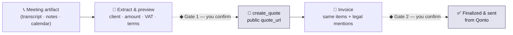

# meet2invoice

**A sales call becomes a sent Qonto invoice, with no re-typing.**

A [Claude Code](https://claude.com/claude-code) skill on the official Qonto MCP.
Feed it a meeting artifact — a call transcript, notes, a calendar event, in any
of five languages — and it extracts the deal, previews it for your approval,
creates the Qonto quote, and on acceptance finalizes and sends the invoice.
Two confirmation gates, nothing written without your OK.

## Why this matters

After every sales call, someone re-types the deal — scope, amount, VAT,
payment terms — into a finance tool. meet2invoice closes that loop from the
raw meeting artifact straight to a finalized, sent Qonto invoice:

- **Guarded action.** Nothing is written to Qonto without an explicit preview
  and confirmation — once before the quote, once before the invoice.
- **Law-aware.** VAT treatment (domestic / intra-EU reverse charge / export /
  small-business schemes) is decided from the parties' countries via
  [`references/invoicing-law.md`](skills/meet2invoice/references/invoicing-law.md),
  including the mandatory legal mentions — written in the client's language.
- **No money movement.** Quotes and invoices only; payments always stay with
  Qonto and the user's own Strong Customer Authentication.

## Quick start

1. Connect the [Qonto MCP server](https://qonto.com) in Claude Code.
2. Copy this folder into your skills directory (or clone `qonto/skills`).
3. Feed it a meeting artifact:

   - "Here's the transcript from my Bouygues call — meet2invoice it."
   - 🇩🇪 "Mach aus diesem Telefonprotokoll ein Angebot und dann die Rechnung."
   - 🇫🇷 "Cet appel est clôturé — facture en autoliquidation, TVA 0, mentions OK."
   - 🇮🇹 "Deal chiuso: crea la fattura, IVA 22%, serve il codice destinatario SdI."
   - 🇪🇸 "Crea un borrador de factura con IVA 21%, pero no la emitas ni la envíes."

## Production-ready

Every call is a GA Qonto Business API endpoint through the official MCP, and
the flow was validated end-to-end against the official Qonto sandbox. The
skill documents what changes in production (SCA prompts on sensitive writes,
multi-account IBAN selection, manual-numbering orgs, currency handling,
FR/DE/IT e-invoicing mandates, payment links once a provider is connected) and
handles cases beyond the happy path: existing-quote escalation, B2C vs B2B
VAT, non-EU exports, seller small-business schemes (§19 UStG / art. 293 B CGI),
credit notes and payment lifecycle after send.

## What this skill deliberately does NOT do

- It never moves money, creates transfers, or touches payment approval.
- It never sends an invoice without the second confirmation gate.
- It does not give legal or tax advice; it applies documented invoicing rules
  and asks when data (VAT ID, rate, country, tax ID) is missing.
- Recurring/retainer invoices and deposit (down-payment) invoices are not
  automated yet — create them in Qonto directly; the skill focuses on the
  deal-to-first-invoice loop.

## Contents

| Path | Purpose |
|---|---|
| `skills/meet2invoice/SKILL.md` | The skill definition (flow, gates, verified tool chain, error handling) |
| `skills/meet2invoice/references/invoicing-law.md` | Per-country VAT / e-invoicing rules used at extraction time |

---

Built by Dr. Martin Kaiser · [Kaiser Data & AI](https://kaiser-data-ai.de)
