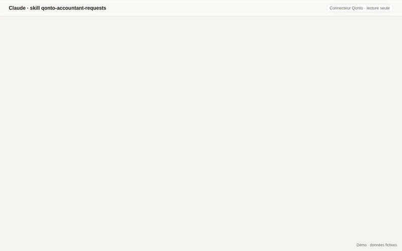

# Answer my accountant's requests

Paste the message from your accountant ("we are missing the March statement,
the receipt for the 450 EUR debit of 3 April and an explanation of the 2 May
transfer") and get back:

- the documents found in Qonto (statements, transaction attachments, invoices);
- what is still missing, with the next action for each item;
- a draft reply to review and send yourself.

The skill is read-only: it never modifies your Qonto account and never sends
anything.

## Example prompts

- "Voici le mail de mon comptable, prépare la réponse avec les pièces."
- "My bookkeeper needs the January statement and two receipts, here is the email."

## Qonto MCP tools used

Read-only: `get_organization`, `list_bank_accounts`, `list_statements`,
`get_statement`, `list_transactions`, `get_transaction`,
`list_transaction_attachments`, `get_attachment`, `list_client_invoices`,
`get_client_invoice`, `list_supplier_invoices`, `get_supplier_invoice`.
